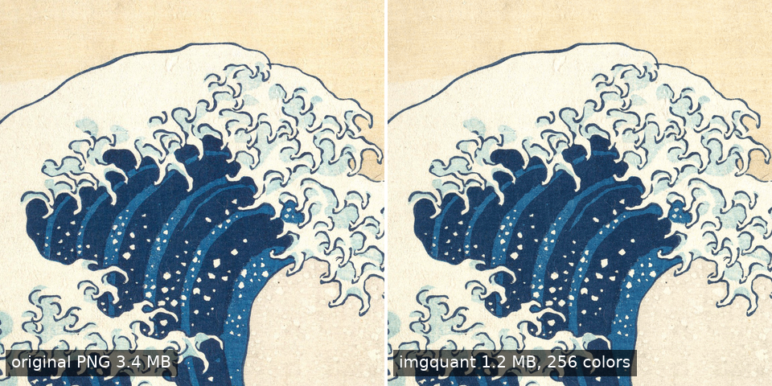

# libimgquant

[](https://crates.io/crates/libimgquant)
[](https://docs.rs/libimgquant)
[](#license)
[](#rust)
<!-- CI badge, once the repository is public: [](https://github.com/kiwina/libimgquant/actions/workflows/ci.yml) -->

Lossy PNG compression like pngquant, under a BSD license: libimgquant is a rewrite of
libimagequant 2.4.1, the last BSD-licensed release of the library behind pngquant (2.5 and
later, including the Rust crate imagequant 4, are GPL-3), with improvements from color
quantization research. It is pure Rust and comes as a Rust crate, a command-line tool, a C
library, and npm and PyPI packages.



*Left, a 1600x1076 truecolor PNG; right, `imgquant`'s output at its default settings; the
same crop of both at full size. The labels give the sizes of the whole files. The Great Wave
off Kanagawa, Katsushika Hokusai, public domain, via
[Wikimedia Commons](https://commons.wikimedia.org/wiki/File:Tsunami_by_hokusai_19th_century.jpg).*

- **License:** BSD-2-Clause, plus Jef Poskanzer's original permissive notice. No code from
  the GPL releases.
- **Results:** on a private 22-image test set at speeds 1 and 3, as fast as imagequant 4.4.1
  without dithering and 1.3–1.5 times as fast with it, better on SSIMULACRA2, butteraugli and
  CIEDE2000, and 9–12% smaller PNGs; at speed 10 the results are mixed
  ([Comparison](#comparison)).
- **Pure Rust:** `#![forbid(unsafe_code)]`, no C code, no build script. The C API's unsafe
  code is in its own crate.
- **Ships as:** the `libimgquant` crate, the pngquant-style `imgquant` tool, a C library with
  the libimagequant 2.4.x API, an npm package (WebAssembly) and a Python package.

## Install

```bash
cargo add libimgquant      # Rust; add --features png to read and write PNG files
cargo install imgquant     # command-line tool
npm install libimgquant    # JavaScript and WebAssembly
pip install libimgquant    # Python
cargo cinstall --release -p libimgquant-capi   # C library, in a checkout (cargo-c)
```

Prebuilt `imgquant` binaries for Linux, macOS and Windows are attached to each
[GitHub release](https://github.com/kiwina/libimgquant/releases); `cargo binstall imgquant`
downloads the right one.

## Usage

libimgquant converts 24/32-bit RGBA images to 8-bit palette images with alpha, for small
PNGs and high-quality GIFs. It works on pixels, not files: RGBA pixels go in, and a palette
of up to 256 colors plus one index per pixel come out, so any image decoder and encoder can
be used around it. The built-in file support (the `png` feature, the command-line tool,
`compressPng` and `compress_png`) reads and writes PNG.

### Rust

The dependencies are [`rgb`](https://crates.io/crates/rgb) for the pixel type, and
optionally [`rayon`](https://crates.io/crates/rayon) (feature `threads`, on by default) and
[`png`](https://crates.io/crates/png) (feature `png`). The minimum supported Rust version is
1.85. API documentation is on [docs.rs](https://docs.rs/libimgquant).

```rust
let (width, height) = (640, 480);
let pixels: Vec<libimgquant::RGBA> = load_rgba_somehow();

let mut attr = libimgquant::new();
attr.set_speed(3)?;              // 1 (best) ..= 10 (fastest)
attr.set_quality(65, 90)?;       // like JPEG quality; fail below 65, aim for 90
attr.set_max_colors(256)?;

let mut image = attr.new_image(pixels, width, height, 0.0)?; // gamma 0 = sRGB
let mut result = attr.quantize(&mut image)?;
result.set_dithering_level(1.0)?; // the default is 0 (no dithering), as in 2.4.1

let (palette, indices) = result.remapped(&mut image)?;
// palette: Vec<RGBA>, translucent entries first; indices: one u8 per pixel
```

Images can be created from:

- owned pixels: `new_image`, `new_image_stride`;
- borrowed pixels: `new_image_borrowed`, `new_image_stride_borrowed`;
- separate rows: `new_image_rows`;
- a row callback: `new_image_fn`.

Remap with `remapped`, `remap_into` (a contiguous buffer) or `remap_rows`. One
`QuantizationResult` can remap several images, but each remap fits the palette to its image
(the default profile reorders it, and dithering can adjust its colors), so use the palette
that comes with each remap: `remapped` returns it, and `palette()` gives it after
`remap_into` or `remap_rows`. For one palette shared by several images, use a
[`Histogram`](#one-palette-for-many-images).

With `set_quality(min, target)`, the quantizer uses the fewest colors that reach the target.
If even `max_colors` colors stay below the minimum, `quantize` fails with
`Error::QualityTooLow`, so the caller can keep the original image.

#### Other image formats

Any decoder that gives 8-bit RGBA works. With the [`image`](https://crates.io/crates/image)
crate, for example, the pixels can be borrowed without a copy (`as_rgba` comes from
`rgb = "0.8"`):

```rust
use rgb::FromSlice;

let img = image::open("photo.jpg")?.into_rgba8();
let (width, height) = (img.width() as usize, img.height() as usize);
let mut image = attr.new_image_borrowed(img.as_raw().as_rgba(), width, height, 0.0)?;
```

#### One palette for many images

For animated GIFs, sprite sheets or tile sets, collect the colors of all images in a
`Histogram` and quantize that. Each image is weighted as `quantize` would weight it, so
colors that appear in only one frame still get palette entries, and every image is remapped
to exactly the same palette:

```rust
let mut histogram = libimgquant::Histogram::new(&attr);
for frame in &mut frames {
    histogram.add_image(&attr, frame)?; // all with the same gamma
}
let mut result = histogram.quantize(&attr)?;
result.set_dithering_level(1.0)?;
let palette = result.palette_vec(); // e.g. the GIF's global color table
for frame in &mut frames {
    let (_, indices) = result.remapped(frame)?;
    // ...
}
```

`add_colors` adds colors with pixel counts from elsewhere, and `add_fixed_color` reserves
palette entries, for example the one transparent color of a GIF.
`examples/animated_gif.rs` turns PNG frames into an animated GIF this way:

```bash
cargo run --release --features png --example animated_gif -- out.gif frame*.png --compare
```

#### PNG files

With the `png` feature (`cargo add libimgquant --features png`), `libimgquant::png_io`
converts a PNG file in one call, like pngquant, keeping its gamma and ICC profile:

```rust
let mut attr = libimgquant::new();
attr.set_quality(65, 90)?;
// input: the bytes of a PNG file
let (output, quality) = libimgquant::png_io::compress_png(&input, &attr, 1.0)?;
```

`decode` reads any PNG as RGBA with its gamma and ICC profile, and `encode_indexed` writes
the palette image with the `PngMetadata` it is given (`DecodedPng::metadata()` keeps both).
`decode` rejects images over `i32::MAX` pixels before allocating anything and fails early
on files with too little image data, but its memory use still grows with the image size (up
to about 33,000 times the file size for flat 1-bit images), so services that decode
untrusted files should limit the width and height (bytes 16-23 of the file), not only the
file size. Only an RGB ICC profile is written, since the output is a palette image.

To get equally small files from another encoder, do what `encode_indexed` does:

- **Two encodings:** write the image once with filter type None and once with per-row
  filters (the png crate's `Filter::MinEntropy`), and keep the smaller. The default profile
  orders the palette so that colors that touch in the image get close indices, which makes
  filtered encodings smaller.
- **Bit depth:** pack small palettes into 1, 2 or 4 bits per pixel.
- **tRNS:** stop the chunk after the last translucent entry. Translucent entries always
  come first.
- **No adaptive filtering on its own:** the png crate's default filter makes palette images
  larger: about 5% with the default profile's ordered palette, 16–23% without it
  (`Profile::Compat`, or speeds 8–10).

The [crate documentation](https://docs.rs/libimgquant/latest/libimgquant/#writing-pngs) has
an example with the `png` crate alone.

#### Features

- `threads` (default): runs quantization and remapping in parallel with rayon. Output is the
  same for any number of threads. Use `default-features = false` for a single-threaded build
  without the rayon dependency; its output can differ from the threaded build in the last
  bits.
- `png`: the `png_io` module (PNG decoding and size-conscious palette PNG encoding with the
  [png](https://crates.io/crates/png) crate). The `imgquant` command-line tool uses it.

### Command line

[`imgquant`](https://crates.io/crates/imgquant) is a pngquant-style command-line tool built on
this crate, with pngquant's options and its exit codes for skipped files (15, 98 and 99). It
reads and writes PNG files:

```bash
imgquant --quality 65-90 photo.png           # writes photo-fs8.png
imgquant 64 --nofs --ext .png --force *.png  # 64 colors, no dithering, in place
```

On the private 22-image test set, the default settings shrink the PNGs to 30% of their total
size in 3.4 s (14 threads). See [imgquant on crates.io](https://crates.io/crates/imgquant) for
all options.

### JavaScript and WebAssembly

The npm package [`libimgquant`](https://www.npmjs.com/package/libimgquant) (directory `wasm/`)
is this library compiled to WebAssembly, for browsers and Node.js 18 or later: one ES module
with TypeScript types and no dependencies. The `.wasm`, PNG codec included, is about 480 KB
(190 KB gzipped).

```js
import { compressPng, quantize, quantizeFrames } from "libimgquant";

const png = compressPng(inputPng, { quality: [65, 90] }); // like pngquant
const { palette, indices } = quantize(imageData.data, width, height, { maxColors: 64 });
const { palette: shared, frames } = quantizeFrames(rgbaFrames, width, height); // one palette for all frames
```

`quantize` takes RGBA bytes, for example from a canvas, so any format the browser decodes
works. The WebAssembly build is single-threaded. See the
[npm package's README](https://www.npmjs.com/package/libimgquant) for the options;
`wasm/build.sh` builds the package.

### Python

The [`libimgquant`](https://pypi.org/project/libimgquant/) package (directory `python/`, built
with PyO3 and maturin) has one wheel per platform for CPython 3.9 and newer (stable ABI) and no
run-time dependencies:

```python
import libimgquant

small = libimgquant.compress_png(open("photo.png", "rb").read(), quality=(65, 90))

result = libimgquant.quantize(rgba, width, height, max_colors=64)  # bytes or a uint8 numpy array
result.palette, result.indices, result.quality
```

`quantize_frames` computes one palette for several images, and `quantize_image` takes and
returns Pillow images, so any format Pillow opens works. Every function releases the GIL
while it works. See the [PyPI page](https://pypi.org/project/libimgquant/).

### C API

The crate [`libimgquant-capi`](https://crates.io/crates/libimgquant-capi) (workspace member
`capi`) builds a shared library (`libimgquant.so`, `libimgquant.dylib` or `imgquant.dll`)
and a static library, with the header `libimgquant.h`. The header has the libimagequant 2.4.x
API, so C and C++ programs written for 2.4.x only need a new include and `-limgquant`:

```bash
cargo build --release -p libimgquant-capi
cc -I capi/assets example.c -L target/release -limgquant -o example
```

`cargo cinstall` ([cargo-c](https://crates.io/crates/cargo-c)) also installs the header and a
`libimgquant.pc` pkg-config file. The C API's unsafe code is confined to that crate; this
crate stays `#![forbid(unsafe_code)]`. See
[libimgquant-capi on crates.io](https://crates.io/crates/libimgquant-capi) for the file names on
each platform and the differences from 2.4.x.

## Comparison

Measured with 3.0.0 on 2026-10-22, on a private set of 22 images under mixed licenses
(18.5 megapixels: photos, paintings, textures, sprites with alpha, UI screenshots, flat art),
at 256 colors, speed 3 and no dithering. SSIMULACRA2 is better when higher, the other
columns when lower.

| Library | Time | SSIMULACRA2 | butteraugli | CIEDE2000 | PNG size |
| --- | --- | --- | --- | --- | --- |
| **libimgquant 3** (`Improved`) | **1.39 s** | **88.30** | **0.708** | **0.527** | **3.54 MB** |
| 2.4.1 port (`Compat`) | 4.73 s | 86.43 | 0.864 | 0.548 | 3.77 MB |
| imagequant 4.4.1 (GPL) | 1.44 s | 87.38 | 0.799 | 0.535 | 3.89 MB |

Against imagequant 4.4.1, at every measured setting of speeds 1 and 3, version 3 is about as
fast without dithering and 1.3–1.5 times as fast with it, scores better on all three metrics
and writes 9–12% smaller PNGs. At speed 10 it
scores better on SSIMULACRA2 and butteraugli and uses 7× less memory at about the same file
size; CIEDE2000 is about 2% behind, and without dithering it is about 10% slower.

imagequant 4.4.1, the newest GPL libimagequant release when measured, was run as a black box
through its public API, for reference only. Its figures and the peak-memory figures come from
a one-off comparison program that is not published; [`tools/iqeval`](tools/iqeval/README.md)
measures the libimgquant columns on any directory of PNG files.
[BENCHMARKS.md](BENCHMARKS.md) has every setting and how it was measured.

## Where it comes from

libimgquant 3 was made in two steps, and both remain available as a `Profile`:

1. **The 2.4.1 port** (`Profile::Compat`):
   [libimagequant 2.4.1](https://github.com/ImageOptim/libimagequant/tree/2.4.1) rewritten in
   Rust, step by step.
2. **Version 3** (`Profile::Improved`, the default): new algorithms from color quantization
   research, built on the port.

Select one with `Attributes::set_profile`, `--profile` in the command-line tool, `profile`
in the npm and Python packages, or `liq_set_profile` in the C API.

**Stability:** the API follows semantic versioning. `Compat` output changes only to fix bugs.
The exact palettes and indices of `Improved` may change in a 3.x minor release as the
algorithms improve.

### libimagequant 2.4.1 and the license

libimagequant is the library behind pngquant. Version 2.4.1 (tag `2.4.1`, commit
`976e021cda07c14cd36630f611a5a6eb2cafc28e`) is its last BSD-licensed release; 2.5 and later,
including the Rust crate imagequant 4, are GPL-3.

- **Source:** the port was made only from the 2.4.1 sources. No code from the GPL releases
  was used; the improvements come from published papers and the project's own work.
- **License:** BSD-2-Clause, plus Jef Poskanzer's original permissive notice, as in 2.4.1.
  See [LICENSE](LICENSE) and [NOTICE](NOTICE).
- **100% Rust:** `#![forbid(unsafe_code)]`, no C, no build script, no FFI. The C API is a
  separate crate.

### The 2.4.1 port (`Compat`)

`Profile::Compat` reproduces 2.4.1 step by step, including its mixed `f32`/`f64`
arithmetic. Golden-hash tests (`tests/golden.rs`) freeze its output. It departs from 2.4.1
only where 2.4.1 had bugs or platform-dependent behavior, and these changes apply to both
profiles:

- **Bug fixes:**
  - garbage edge-map values for high-contrast pixels (a negative float converted to a byte);
  - wrong contrast maps for images over about 4 megapixels (one row buffer reused for three
    rows);
  - `set_dithering_level` validating the previous value instead of the new one;
  - a palette rounded with the previous gamma after `set_output_gamma`;
  - a median-cut recursion that could overflow the stack;
  - out-of-bounds reads in rare edge cases.
- **Same output everywhere:**
  - dithering noise from the crate's own seeded generator (the lagged-Fibonacci algorithm of
    GNU `random()`) instead of the global `rand()`;
  - a fixed sort tie order instead of the platform's `qsort` order;
  - little-endian histogram hashing;
  - the dither map threshold at speed 5 in every build (2.4.1 used 7 in OpenMP builds).
- **Threads:** with the `threads` feature, parallel sums use fixed work chunks, so output does
  not depend on the number of threads. The build without threads sums in exactly the original
  order, so its output can differ from the threaded build in the last bits.
- **Faster, same output:** the nearest-color search is vectorized and prunes with the
  triangle inequality, and the histogram, pixel conversion, contrast and dither maps, k-means
  iterations and remapping run in parallel.

[CHANGELOG.md](CHANGELOG.md) has the details.

### What is new in version 3

`Profile::Improved`, the default, replaces these parts of the port:

| Area | Version 3 (`Improved`) | Basis |
| --- | --- | --- |
| Color difference | 2.4.1's internal gamma with an OKLab-shaped opponent matrix (lightness plus two chroma axes), keeping 2.4.1's premultiplied alpha and black/white blending | Ottosson (2020) |
| Median cut | Splits along the principal axis at the error-optimal point; the box with the largest error is split first | Wan, Prusinkiewicz & Wong (1990); Orchard & Bouman (1991); Wu (1991, 1992) |
| Refinement | Weighted Hartigan moves after k-means (Lloyd) | Hartigan & Wong (1979); Telgarsky & Vattani (2010) |
| Nearest color | Exact search: the color difference is a squared Euclidean distance, so a switching triangle-inequality search finds the true nearest color | Orchard (1991); Phillips (2002) |
| Dithering | Serpentine Floyd-Steinberg in parallel 64-row strips with warm-up rows; seamless and deterministic | — |
| Palette order | Colors that touch in the image get adjacent indices (speeds 1–7), which makes filtered PNGs smaller; translucent entries stay first | Zeng, Li & Lei (2000); Pinho & Neves (2004, 2006) |
| Speed presets | Fewer repeated median cuts and k-means iterations, since the refinement does that work better | measured on the test corpus |

References:

- Ottosson, *A perceptual color space for image processing*, 2020.
- Wan, Prusinkiewicz & Wong, *Variance-based color image quantization for frame buffer
  display*, Color Research & Application 15(1), 1990.
- Orchard & Bouman, *Color quantization of images*, IEEE Transactions on Signal Processing
  39(12), 1991.
- Wu, *Efficient statistical computations for optimal color quantization*, Graphics Gems II,
  1991; *Color quantization by dynamic programming and principal analysis*, ACM Transactions
  on Graphics 11(4), 1992.
- Hartigan & Wong, *A k-means clustering algorithm*, Applied Statistics 28(1), 1979.
- Telgarsky & Vattani, *Hartigan's method: k-means clustering without Voronoi*, AISTATS 2010.
- Orchard, *A fast nearest-neighbor search algorithm*, ICASSP 1991.
- Phillips, *Acceleration of k-means and related clustering algorithms*, ALENEX 2002.
- Zeng, Li & Lei, *An efficient color re-indexing scheme for palette-based compression*,
  ICIP 2000.
- Pinho & Neves, *A survey on palette reordering methods for improving the compression of
  color-indexed images*, IEEE Transactions on Image Processing 13(11), 2004; *On the relation
  between Memon's and the modified Zeng's palette reordering methods*, Image and Vision
  Computing 24, 2006.

## Switching to libimgquant

### From libimagequant 2.4 (C)

C and C++ programs can keep their code: the [C API](#c-api) has the 2.4.x header, so only the
include and `-limgquant` change. To move to the Rust API:

| libimagequant 2.4.1 | libimgquant |
| --- | --- |
| `liq_attr_create`, `liq_attr_copy`, `liq_attr_destroy` | `Attributes::new()` / `libimgquant::new()`, `Clone`, `Drop` |
| `liq_set/get_max_colors`, `_speed`, `_min_opacity`, `_min_posterization` | `set_*` and getter methods on `Attributes` |
| `liq_set_quality`, `liq_get_min_quality`, `liq_get_max_quality` | `set_quality(min, target)`, `quality() -> (min, target)` |
| `liq_set_last_index_transparent` | `set_last_index_transparent(bool)` |
| `liq_set_log_callback`, `liq_set_log_flush_callback` | `set_log_callback`, `set_log_flush_callback` (closures) |
| `liq_image_create_rgba`, `_rgba_rows`, `_custom` | `new_image*`, `new_image_rows`, `new_image_fn` |
| `liq_image_add_fixed_color`, `liq_image_get_width/height` | `Image::add_fixed_color`, `width()`, `height()` |
| `liq_quantize_image` | `Attributes::quantize(&mut image) -> Result<QuantizationResult, Error>` |
| `liq_set_dithering_level`, `liq_set/get_output_gamma` | methods on `QuantizationResult` |
| `liq_get_palette` | `QuantizationResult::palette() -> &[RGBA]` |
| `liq_write_remapped_image(_rows)` | `remap_into`, `remap_rows`, `remapped` |
| `liq_get_quantization_error/quality` | `quantization_error()`, `quantization_quality()` (`None` = not measured yet) |
| `liq_error` | `Error` (only the variants that can occur) |

The Rust API doesn't need custom allocators, `liq_image_set_memory_ownership`, handle
validity checks or `liq_version`, because Rust ownership replaces them; the
[C API](#c-api) provides all of them.

### From imagequant 4 (Rust)

The API has the shape of imagequant 4's: `new()`, `Attributes`, `Image`,
`QuantizationResult`, `Histogram` and `HistogramEntry`, with the same names and arguments for
the common calls (`new_image`, `new_image_borrowed`, `set_speed`, `set_quality`, `quantize`,
`set_dithering_level`, `remapped`, `palette`, the `Histogram` methods, ...) and the same
`threads` feature. Renaming the dependency keeps `use imagequant::...` working:

```toml
[dependencies]
imagequant = { package = "libimgquant", version = "3" }
```

The differences from imagequant 4.4.1:

- **Defaults:** speed 3 instead of 4, and dithering level 0 instead of 1. Call
  `set_speed(4)` and `set_dithering_level(1.0)` for imagequant's defaults.
- **`remap_into`** takes `&mut [u8]` instead of `&mut [MaybeUninit<u8>]`.
- **Image constructors** are `Attributes` methods only: `attr.new_image(...)`,
  `new_image_borrowed`, `new_image_stride` and `new_image_stride_borrowed` replace
  `Image::new(&attr, ...)`, `Image::new_borrowed`, `Image::new_stride` and
  `Image::new_stride_borrowed`. The row callback is `attr.new_image_fn(...)`, which is safe
  and fills `&mut [RGBA]` rows; `Image::new_fn` is `unsafe` and fills `MaybeUninit` rows.
- **`Error`** has only `QualityTooLow`, `ValueOutOfRange`, `OutOfMemory` and
  `BufferTooSmall`, without numeric values.
- **Not available:** `Image::set_importance_map`, `Image::set_background`, `Clone` for
  `Image`, the progress callbacks (`set_progress_callback`, `ControlFlow`),
  `remap_into_vec`, `remapping_error`, `remapping_quality`, `palette_len` and
  `QuantizationResult::from_palette` (use a `Histogram` with `add_fixed_color` instead).
- **Output:** different palettes and indices. `Profile::Compat` reproduces libimagequant
  2.4.1, not imagequant 4.

## License

BSD-2-Clause, plus the original permissive notice by Jef Poskanzer. See [LICENSE](LICENSE)
and [NOTICE](NOTICE).
